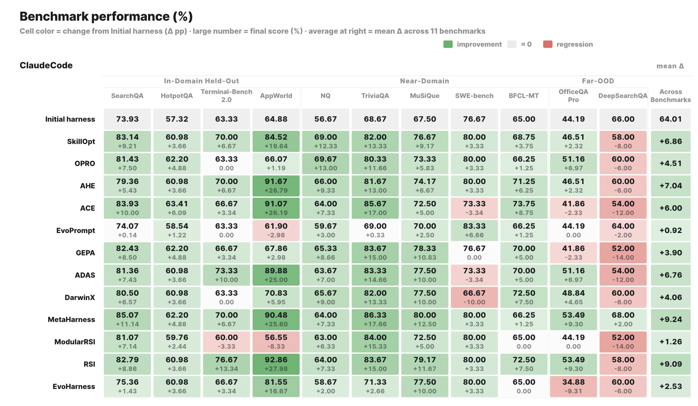
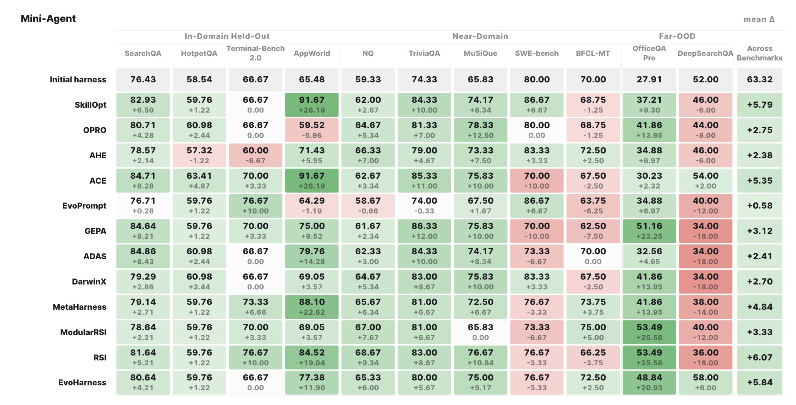
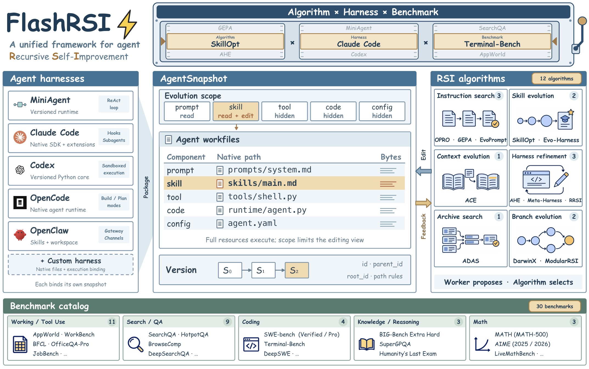

<p align="center">
  
</p>

<h1 align="center">FlashRSI: A Unified Framework for Agent Self-Improvement</h1>

<p align="center"><i>One click to reproduce, compare, and develop RSI methods across agents and tasks.</i></p>

<p align="center">
  FlashRSI provides one experiment interface for <b>12 RSI algorithms</b>, <b>30 benchmarks</b>, and native
  integrations for MiniAgent, Claude Code, and Codex. Each run records the resources that changed, the
  trajectories that produced the score, and the Snapshot selected at the end.
</p>

<p align="center">
  <a href="https://arxiv.org/search/?query=FlashRSI&amp;searchtype=all"></a>
  <a href="https://huggingface.co/datasets/RUC-NLPIR/FlashRSI"></a>
  <a href="https://deepwiki.com/RUC-NLPIR/FlashRSI"></a>
  <a href="LICENSE"></a><br>
  <a href="https://ruc-nlpir.github.io/FlashRSI/project.html"></a>
  <a href="https://ruc-nlpir.github.io/FlashRSI/"></a>
</p>

<p align="center">
  <b>English</b> · <a href="README.zh-CN.md">简体中文</a>
</p>

<p align="center">
  <a href="#installation">Installation</a> &nbsp;/&nbsp;
  <a href="#features">Features</a> &nbsp;/&nbsp;
  <a href="#quick-start">Quick start</a> &nbsp;/&nbsp;
  <a href="#design-logic">Design Logic</a> &nbsp;/&nbsp;
  <a href="#supporting-methods">Supporting Methods</a> &nbsp;/&nbsp;
  <a href="#supporting-benchmarks">Supporting Benchmarks</a>
</p>


<a id="demo"></a>
<p align="center">
  
</p>

<p align="center">
  <a href="assets/readme/overall-result-1.jpg">
    
  </a>
</p>

<p align="center">
  <a href="assets/readme/overall-result-2.jpg">
    
  </a>
</p>

## Features

- 🧩 **Configurable Experiment Framework**: Combines an RSI method, Target harness, Worker, benchmark,
  and independent model settings in one YAML/CLI experiment. Resource scopes and execution roles can
  change without writing a new runner.
- 🧪 **30 Benchmarks and 12 RSI Methods**: Covers question answering, reasoning, mathematics, coding,
  web research, documents, tool use, and interactive tasks, with **34 pinned Hugging Face prepared
  configurations** for 29 suites, plus runnable adaptations of OPRO, GEPA, EvoPrompt, ACE, SkillOpt,
  Evo-Harness, AHE, ADAS, DarwinX, Meta-Harness, ModularRSI, and RRSI.
- 🧠 **Native Harnesses and Reproducible Evidence**: MiniAgent, Claude Code, and Codex map prompts,
  skills, tools, configuration, hooks, plugins, memory, and runtime resources into versioned Snapshots.
  Each run keeps immutable candidates, redacted configuration, Target/Worker trajectories, metrics,
  usage, and task artifacts together.
- 🚀 **Simple Workflow and Extensible Docs**: Use `flashrsi run` for evolution and `flashrsi evaluate`
  for saved Snapshots, with method examples, a searchable documentation site, and GitHub Pages support.
  Pi, Hermes, and OpenCode integrations are in progress.

See the [documentation home](docs/index.md) for the guide, integrations, and development notes.

<p align="center">
  <a href="assets/readme/framework-overview.jpg">
    
  </a>
</p>

## Installation

To install the framework and all non-Harbor benchmark integrations, use the
single `all` extra:

```bash
git clone https://github.com/RUC-NLPIR/FlashRSI.git
cd FlashRSI
uv venv --python 3.12
source .venv/bin/activate
uv sync --extra all
```

or using `pip`:
```bash
python -m pip install -e ".[all]"
```

Harbor is kept as a separate extra. Install it together with the complete
environment when you need Harbor tasks:
```bash
uv sync --extra all --extra harbor
```
or using `pip`:
```bash
python -m pip install -e ".[all,harbor]"
```

For Docker-backed tasks, install [Docker Desktop](https://docs.docker.com/get-docker/) or Docker Engine.

## Quick start

Run a small RSI experiment with explicit algorithm, benchmark, and target
harness choices:

```bash
export TARGET_API_KEY="..."
export WORKER_API_KEY="..."

flashrsi run \
  --algorithm skillopt \
  --benchmark searchqa \
  --agent-harness miniagent \
  --model deepseek-v4.1-pro \
  --worker-model deepseek-v4.1-flash \
  --set agent.llm.api_key="$TARGET_API_KEY" \
  --set algorithm.worker.llm.api_key="$WORKER_API_KEY"
```

The same experiment can be started entirely from the checked-in YAML file:

```bash
flashrsi run --config examples/quickstart.yaml
```

### Run options

The CLI keeps the common choices short and accepts every nested configuration field through a dotted
override. `--algorithm` chooses the RSI search method, while `--agent-harness` chooses the harness whose
resources are evolved. Use `flashrsi run --help` for the complete parser help.

| Option | Purpose |
| --- | --- |
| `--config PATH` | Load an existing YAML experiment, including its data, split, and role settings. Start with [`examples/quickstart.yaml`](examples/quickstart.yaml). |
| `--algorithm NAME`, `--algo NAME` | Select the RSI method that proposes and evaluates candidate edits. See [Supporting Methods](#supporting-methods). |
| `--benchmark NAME` | Select the task suite and scoring protocol used to evaluate candidates. See [Supporting Benchmarks](#supporting-benchmarks). |
| `--agent-harness NAME`, `--agent NAME` | Select the Target harness to evolve and execute. See [Supporting Harnesses](#supporting-harnesses). |
| `--model NAME` | Set the Target model used to solve benchmark tasks. |
| `--worker-model NAME` | Set the independent Worker model used to propose edits; Agent Workers can be selected through `--set algorithm.worker.type=agent`. |
| `--output-dir PATH` | Choose the parent directory for run records, Snapshots, trajectories, and artifacts. |
| `--set PATH=VALUE` | Override any nested setting, such as `--set algorithm.max_steps=3` or `--set algorithm.worker.name=codex`. |
| `--check-only` | Check dependencies and data preparation without calling models or creating an experiment result. |
| `--prepare-only` | Write a redacted configuration directory without checking runtime readiness. |

After the run completes, the following artifacts are produced:

```text
runs/<algorithm>-<agent>-<benchmark>-<timestamp>/
├── config.yaml           # Redacted configuration
├── snapshots/            # Candidate resources and lineage
├── trajectories/         # Target rollouts, Worker calls, and decisions
├── artifacts/harbor/     # Collected files and native logs for Harbor tasks
├── result.json           # Selected Snapshot and final test result
├── end-summary.json      # Machine-readable summary
└── end-summary.md        # Human-readable summary
```

### Evaluate a Snapshot

Use `evaluate` to test how an evolved harness performs on another benchmark without running evolution.
Any JSON file under a run's
`snapshots/` directory can be used, including an intermediate candidate:

```bash
flashrsi evaluate \
  --config examples/quickstart.yaml \
  --snapshot <run-dir>/snapshots/<snapshot-id>.json
```


## Design Logic

FlashRSI represents an agent harness as a small, tagged file system. A Snapshot contains the files that
define the agent's behavior, while credentials, downloaded data, temporary logs, and task state remain
outside the Snapshot. Every file is assigned a role such as `prompt`, `skill`, `tool`, `runtime`, or
`config`; an algorithm declares which roles it may observe and edit.

```text
AgentSnapshot (tagged files)
        │
        ├── selected scope ──► RSI algorithm edits and versions a candidate
        │
        └── complete candidate ──► Harness executes ──► Benchmark scores trajectories
```

This boundary lets algorithms share the same checkout, execution, and scoring operations while keeping
their search policies independent. The harness always executes a complete candidate, so editing one skill
still preserves the instructions, tools, and runtime that make that skill effective.

### Harness mapping strategies

| Harness type | How FlashRSI maps it | Current example |
| --- | --- | --- |
| Closed or interface-first | Map the stable interfaces exposed by the product to files. The Snapshot contains the resources that can be edited; proprietary internals stay in the native harness. | Claude Code: instructions, skills, agents, hooks, MCP/LSP registrations, and settings. |
| Open source with a large runtime | Reduce the execution surface against a pinned baseline, document supported behavior and migration limits, then align that implementation with the Snapshot file layout. | Codex: a Python semantic port of supported paths from a pinned Rust baseline; selected resources execute from the Snapshot in an isolated process. |
| Clean open source harness | Map the source tree directly and tag each editable file by role. The native entry point continues to execute the selected Snapshot. | MiniAgent: prompts, skills, tools, configuration, and declared runtime code. |

See [Agent integration](docs/agent-integration.md), [Codex integration](docs/codex.md), and the
[usage guide](docs/usage.md#how-it-works) for implementation details.

## Supporting Methods

FlashRSI implements 12 RSI methods:

| Method | Scope | Search organization | Feedback used |
| --- | --- | --- | --- |
| [OPRO](https://arxiv.org/abs/2309.03409) | Instruction search | Scored history · reflection · population | Train scores, outputs |
| [GEPA](https://arxiv.org/abs/2507.19457) | Instruction search | Candidate pool and reflection | Scores, traces |
| [EvoPrompt](https://arxiv.org/abs/2309.08532) | Instruction search | GA / DE population | Dev scores |
| [SkillOpt](https://arxiv.org/abs/2605.23904) | Skill evolution | Fast / slow updates | Train traces, dev scores |
| [Evo-Harness](https://arxiv.org/abs/2608.15071v2) | Skill evolution | Task-stream accumulation | Failure traces |
| [ACE](https://arxiv.org/abs/2510.04618) | Context evolution | Playbook accumulation | Task feedback, reflections |
| [AHE](https://arxiv.org/abs/2604.25850) | Iterative harness refinement | Successive edits | Traces, diagnoses, edit audits |
| [Meta-Harness](https://arxiv.org/abs/2603.28052) | Iterative harness refinement | File-based history | Code, scores, traces |
| [RRSI](https://arxiv.org/abs/2609.24972) | Iterative harness refinement | History-guided revisions | Traces, scores, token costs |
| [ADAS](https://arxiv.org/abs/2408.08435) | Archive search | Design archive | Design accounts, dev scores |
| [DarwinX](https://arxiv.org/abs/2608.07545) | Branch evolution | Branches and recombination | Repeated outcomes, traces |
| [ModularRSI](https://arxiv.org/abs/2609.14857) | Branch evolution | Independent branches; integration | Success / failure traces |

### Overall experiment results

The table below reports source-task performance and frozen transfer performance for the twelve
methods evaluated on Claude Code and Mini-Agent. It covers four source benchmarks, five near-domain
transfers, and two far-OOD transfers. Scores are percentages; each result cell shows the final score
followed by its change from the corresponding initial harness in percentage points, and bold marks the
highest final score within each benchmark and harness, including ties.

<table>
  <thead>
    <tr>
      <th rowspan="2" align="left">Method</th>
      <th rowspan="2" align="left">Target harness</th>
      <th colspan="4" align="center">Source<br><sub>In-domain</sub></th>
      <th colspan="5" align="center">Near-domain<br><sub>Frozen transfer</sub></th>
      <th colspan="2" align="center">Far-OOD<br><sub>Frozen transfer</sub></th>
    </tr>
    <tr>
      <th align="center">SearchQA<br><sub>In-domain</sub></th>
      <th align="center">HotpotQA<br><sub>In-domain</sub></th>
      <th align="center">Terminal-Bench 2.0<br><sub>In-domain</sub></th>
      <th align="center">AppWorld<br><sub>In-domain</sub></th>
      <th align="center">SearchQA → NQ<br><sub>Near-domain</sub></th>
      <th align="center">SearchQA → TriviaQA<br><sub>Near-domain</sub></th>
      <th align="center">HotpotQA → MuSiQue<br><sub>Near-domain</sub></th>
      <th align="center">Terminal-Bench 2.0 → SWE-bench<br><sub>Near-domain</sub></th>
      <th align="center">AppWorld → BFCL Multi-Turn<br><sub>Near-domain</sub></th>
      <th align="center">SearchQA → OfficeQA Pro<br><sub>Far-OOD</sub></th>
      <th align="center">HotpotQA → DeepSearchQA<br><sub>Far-OOD</sub></th>
    </tr>
  </thead>
  <tbody>
    <tr>
      <td rowspan="2" align="left"><strong>Initial harness</strong></td>
      <td align="left">Claude Code</td>
      <td align="center">73.93</td>
      <td align="center">57.32</td>
      <td align="center">63.33</td>
      <td align="center">64.88</td>
      <td align="center">56.67</td>
      <td align="center">68.67</td>
      <td align="center">67.50</td>
      <td align="center">76.67</td>
      <td align="center">65.00</td>
      <td align="center">44.19</td>
      <td align="center">62.00</td>
    </tr>
    <tr>
      <td align="left">Mini-Agent</td>
      <td align="center">76.43</td>
      <td align="center">58.54</td>
      <td align="center">66.67</td>
      <td align="center">65.48</td>
      <td align="center">59.33</td>
      <td align="center">74.33</td>
      <td align="center">65.83</td>
      <td align="center">80.00</td>
      <td align="center">70.00</td>
      <td align="center">27.91</td>
      <td align="center">52.00</td>
    </tr>
    <tr>
      <td rowspan="2" align="left"><strong>SkillOpt</strong></td>
      <td align="left">Claude Code</td>
      <td align="center">83.14<br><sub>+9.21 pp</sub></td>
      <td align="center">60.98<br><sub>+3.66 pp</sub></td>
      <td align="center">70.00<br><sub>+6.67 pp</sub></td>
      <td align="center">84.52<br><sub>+19.64 pp</sub></td>
      <td align="center">69.00<br><sub>+12.33 pp</sub></td>
      <td align="center">82.00<br><sub>+13.33 pp</sub></td>
      <td align="center">76.67<br><sub>+9.17 pp</sub></td>
      <td align="center">80.00<br><sub>+3.33 pp</sub></td>
      <td align="center">68.75<br><sub>+3.75 pp</sub></td>
      <td align="center">46.51<br><sub>+2.32 pp</sub></td>
      <td align="center">36.00<br><sub>-26.00 pp</sub></td>
    </tr>
    <tr>
      <td align="left">Mini-Agent</td>
      <td align="center">82.93<br><sub>+6.50 pp</sub></td>
      <td align="center">59.76<br><sub>+1.22 pp</sub></td>
      <td align="center">66.67<br><sub>0.00 pp</sub></td>
      <td align="center"><strong>91.67</strong><br><sub>+26.19 pp</sub></td>
      <td align="center">62.00<br><sub>+2.67 pp</sub></td>
      <td align="center">84.33<br><sub>+10.00 pp</sub></td>
      <td align="center">74.17<br><sub>+8.34 pp</sub></td>
      <td align="center"><strong>86.67</strong><br><sub>+6.67 pp</sub></td>
      <td align="center">68.75<br><sub>-1.25 pp</sub></td>
      <td align="center">37.21<br><sub>+9.30 pp</sub></td>
      <td align="center">46.00<br><sub>-6.00 pp</sub></td>
    </tr>
    <tr>
      <td rowspan="2" align="left"><strong>OPRO</strong></td>
      <td align="left">Claude Code</td>
      <td align="center">81.43<br><sub>+7.50 pp</sub></td>
      <td align="center">62.20<br><sub>+4.88 pp</sub></td>
      <td align="center">63.33<br><sub>0.00 pp</sub></td>
      <td align="center">66.07<br><sub>+1.19 pp</sub></td>
      <td align="center"><strong>69.67</strong><br><sub>+13.00 pp</sub></td>
      <td align="center">80.33<br><sub>+11.66 pp</sub></td>
      <td align="center">73.33<br><sub>+5.83 pp</sub></td>
      <td align="center">80.00<br><sub>+3.33 pp</sub></td>
      <td align="center">66.25<br><sub>+1.25 pp</sub></td>
      <td align="center">51.16<br><sub>+6.97 pp</sub></td>
      <td align="center">30.00<br><sub>-32.00 pp</sub></td>
    </tr>
    <tr>
      <td align="left">Mini-Agent</td>
      <td align="center">80.71<br><sub>+4.28 pp</sub></td>
      <td align="center">60.98<br><sub>+2.44 pp</sub></td>
      <td align="center">66.67<br><sub>0.00 pp</sub></td>
      <td align="center">59.52<br><sub>-5.96 pp</sub></td>
      <td align="center">64.67<br><sub>+5.34 pp</sub></td>
      <td align="center">81.33<br><sub>+7.00 pp</sub></td>
      <td align="center"><strong>78.33</strong><br><sub>+12.50 pp</sub></td>
      <td align="center">80.00<br><sub>0.00 pp</sub></td>
      <td align="center">68.75<br><sub>-1.25 pp</sub></td>
      <td align="center">41.86<br><sub>+13.95 pp</sub></td>
      <td align="center">44.00<br><sub>-8.00 pp</sub></td>
    </tr>
    <tr>
      <td rowspan="2" align="left"><strong>AHE</strong></td>
      <td align="left">Claude Code</td>
      <td align="center">79.36<br><sub>+5.43 pp</sub></td>
      <td align="center">60.98<br><sub>+3.66 pp</sub></td>
      <td align="center">70.00<br><sub>+6.67 pp</sub></td>
      <td align="center">91.67<br><sub>+26.79 pp</sub></td>
      <td align="center">66.00<br><sub>+9.33 pp</sub></td>
      <td align="center">81.67<br><sub>+13.00 pp</sub></td>
      <td align="center">74.17<br><sub>+6.67 pp</sub></td>
      <td align="center">80.00<br><sub>+3.33 pp</sub></td>
      <td align="center">71.25<br><sub>+6.25 pp</sub></td>
      <td align="center">46.51<br><sub>+2.32 pp</sub></td>
      <td align="center">46.00<br><sub>-16.00 pp</sub></td>
    </tr>
    <tr>
      <td align="left">Mini-Agent</td>
      <td align="center">78.57<br><sub>+2.14 pp</sub></td>
      <td align="center">57.32<br><sub>-1.22 pp</sub></td>
      <td align="center">60.00<br><sub>-6.67 pp</sub></td>
      <td align="center">71.43<br><sub>+5.95 pp</sub></td>
      <td align="center">66.33<br><sub>+7.00 pp</sub></td>
      <td align="center">79.00<br><sub>+4.67 pp</sub></td>
      <td align="center">73.33<br><sub>+7.50 pp</sub></td>
      <td align="center">83.33<br><sub>+3.33 pp</sub></td>
      <td align="center">72.50<br><sub>+2.50 pp</sub></td>
      <td align="center">34.88<br><sub>+6.97 pp</sub></td>
      <td align="center">46.00<br><sub>-6.00 pp</sub></td>
    </tr>
    <tr>
      <td rowspan="2" align="left"><strong>ACE</strong></td>
      <td align="left">Claude Code</td>
      <td align="center">83.93<br><sub>+10.00 pp</sub></td>
      <td align="center"><strong>63.41</strong><br><sub>+6.09 pp</sub></td>
      <td align="center">66.67<br><sub>+3.34 pp</sub></td>
      <td align="center">91.07<br><sub>+26.19 pp</sub></td>
      <td align="center">64.00<br><sub>+7.33 pp</sub></td>
      <td align="center">85.67<br><sub>+17.00 pp</sub></td>
      <td align="center">72.50<br><sub>+5.00 pp</sub></td>
      <td align="center">73.33<br><sub>-3.34 pp</sub></td>
      <td align="center"><strong>73.75</strong><br><sub>+8.75 pp</sub></td>
      <td align="center">41.86<br><sub>-2.33 pp</sub></td>
      <td align="center">36.00<br><sub>-26.00 pp</sub></td>
    </tr>
    <tr>
      <td align="left">Mini-Agent</td>
      <td align="center">84.71<br><sub>+8.28 pp</sub></td>
      <td align="center"><strong>63.41</strong><br><sub>+4.87 pp</sub></td>
      <td align="center">70.00<br><sub>+3.33 pp</sub></td>
      <td align="center"><strong>91.67</strong><br><sub>+26.19 pp</sub></td>
      <td align="center">62.67<br><sub>+3.34 pp</sub></td>
      <td align="center">85.33<br><sub>+11.00 pp</sub></td>
      <td align="center">75.83<br><sub>+10.00 pp</sub></td>
      <td align="center">70.00<br><sub>-10.00 pp</sub></td>
      <td align="center">67.50<br><sub>-2.50 pp</sub></td>
      <td align="center">30.23<br><sub>+2.32 pp</sub></td>
      <td align="center">54.00<br><sub>+2.00 pp</sub></td>
    </tr>
    <tr>
      <td rowspan="2" align="left"><strong>EvoPrompt</strong></td>
      <td align="left">Claude Code</td>
      <td align="center">74.07<br><sub>+0.14 pp</sub></td>
      <td align="center">58.54<br><sub>+1.22 pp</sub></td>
      <td align="center">63.33<br><sub>0.00 pp</sub></td>
      <td align="center">61.90<br><sub>-2.98 pp</sub></td>
      <td align="center">59.67<br><sub>+3.00 pp</sub></td>
      <td align="center">69.00<br><sub>+0.33 pp</sub></td>
      <td align="center">70.00<br><sub>+2.50 pp</sub></td>
      <td align="center"><strong>83.33</strong><br><sub>+6.66 pp</sub></td>
      <td align="center">66.25<br><sub>+1.25 pp</sub></td>
      <td align="center">44.19<br><sub>0.00 pp</sub></td>
      <td align="center">44.00<br><sub>-18.00 pp</sub></td>
    </tr>
    <tr>
      <td align="left">Mini-Agent</td>
      <td align="center">76.71<br><sub>+0.28 pp</sub></td>
      <td align="center">59.76<br><sub>+1.22 pp</sub></td>
      <td align="center"><strong>76.67</strong><br><sub>+10.00 pp</sub></td>
      <td align="center">64.29<br><sub>-1.19 pp</sub></td>
      <td align="center">58.67<br><sub>-0.66 pp</sub></td>
      <td align="center">74.00<br><sub>-0.33 pp</sub></td>
      <td align="center">67.50<br><sub>+1.67 pp</sub></td>
      <td align="center"><strong>86.67</strong><br><sub>+6.67 pp</sub></td>
      <td align="center">63.75<br><sub>-6.25 pp</sub></td>
      <td align="center">34.88<br><sub>+6.97 pp</sub></td>
      <td align="center">40.00<br><sub>-12.00 pp</sub></td>
    </tr>
    <tr>
      <td rowspan="2" align="left"><strong>GEPA</strong></td>
      <td align="left">Claude Code</td>
      <td align="center">82.43<br><sub>+8.50 pp</sub></td>
      <td align="center">62.20<br><sub>+4.88 pp</sub></td>
      <td align="center">66.67<br><sub>+3.34 pp</sub></td>
      <td align="center">67.86<br><sub>+2.98 pp</sub></td>
      <td align="center">65.33<br><sub>+8.66 pp</sub></td>
      <td align="center">83.67<br><sub>+15.00 pp</sub></td>
      <td align="center">78.33<br><sub>+10.83 pp</sub></td>
      <td align="center">76.67<br><sub>0.00 pp</sub></td>
      <td align="center">70.00<br><sub>+5.00 pp</sub></td>
      <td align="center">41.86<br><sub>-2.33 pp</sub></td>
      <td align="center">38.00<br><sub>-24.00 pp</sub></td>
    </tr>
    <tr>
      <td align="left">Mini-Agent</td>
      <td align="center">84.64<br><sub>+8.21 pp</sub></td>
      <td align="center">59.76<br><sub>+1.22 pp</sub></td>
      <td align="center">70.00<br><sub>+3.33 pp</sub></td>
      <td align="center">75.00<br><sub>+9.52 pp</sub></td>
      <td align="center">61.67<br><sub>+2.34 pp</sub></td>
      <td align="center"><strong>86.33</strong><br><sub>+12.00 pp</sub></td>
      <td align="center">75.83<br><sub>+10.00 pp</sub></td>
      <td align="center">70.00<br><sub>-10.00 pp</sub></td>
      <td align="center">62.50<br><sub>-7.50 pp</sub></td>
      <td align="center">51.16<br><sub>+23.25 pp</sub></td>
      <td align="center">34.00<br><sub>-18.00 pp</sub></td>
    </tr>
    <tr>
      <td rowspan="2" align="left"><strong>ADAS</strong></td>
      <td align="left">Claude Code</td>
      <td align="center">81.36<br><sub>+7.43 pp</sub></td>
      <td align="center">60.98<br><sub>+3.66 pp</sub></td>
      <td align="center">73.33<br><sub>+10.00 pp</sub></td>
      <td align="center">89.88<br><sub>+25.00 pp</sub></td>
      <td align="center">63.67<br><sub>+7.00 pp</sub></td>
      <td align="center">83.33<br><sub>+14.66 pp</sub></td>
      <td align="center">77.50<br><sub>+10.00 pp</sub></td>
      <td align="center">73.33<br><sub>-3.34 pp</sub></td>
      <td align="center">70.00<br><sub>+5.00 pp</sub></td>
      <td align="center">51.16<br><sub>+6.97 pp</sub></td>
      <td align="center">42.00<br><sub>-20.00 pp</sub></td>
    </tr>
    <tr>
      <td align="left">Mini-Agent</td>
      <td align="center"><strong>84.86</strong><br><sub>+8.43 pp</sub></td>
      <td align="center">60.98<br><sub>+2.44 pp</sub></td>
      <td align="center">66.67<br><sub>0.00 pp</sub></td>
      <td align="center">79.76<br><sub>+14.28 pp</sub></td>
      <td align="center">62.33<br><sub>+3.00 pp</sub></td>
      <td align="center">84.33<br><sub>+10.00 pp</sub></td>
      <td align="center">74.17<br><sub>+8.34 pp</sub></td>
      <td align="center">73.33<br><sub>-6.67 pp</sub></td>
      <td align="center">70.00<br><sub>0.00 pp</sub></td>
      <td align="center">32.56<br><sub>+4.65 pp</sub></td>
      <td align="center">34.00<br><sub>-18.00 pp</sub></td>
    </tr>
    <tr>
      <td rowspan="2" align="left"><strong>DarwinX</strong></td>
      <td align="left">Claude Code</td>
      <td align="center">80.50<br><sub>+6.57 pp</sub></td>
      <td align="center">60.98<br><sub>+3.66 pp</sub></td>
      <td align="center">63.33<br><sub>0.00 pp</sub></td>
      <td align="center">70.83<br><sub>+5.95 pp</sub></td>
      <td align="center">65.67<br><sub>+9.00 pp</sub></td>
      <td align="center">82.00<br><sub>+13.33 pp</sub></td>
      <td align="center">77.50<br><sub>+10.00 pp</sub></td>
      <td align="center">66.67<br><sub>-10.00 pp</sub></td>
      <td align="center">72.50<br><sub>+7.50 pp</sub></td>
      <td align="center">48.84<br><sub>+4.65 pp</sub></td>
      <td align="center">36.00<br><sub>-26.00 pp</sub></td>
    </tr>
    <tr>
      <td align="left">Mini-Agent</td>
      <td align="center">79.29<br><sub>+2.86 pp</sub></td>
      <td align="center">60.98<br><sub>+2.44 pp</sub></td>
      <td align="center">66.67<br><sub>0.00 pp</sub></td>
      <td align="center">69.05<br><sub>+3.57 pp</sub></td>
      <td align="center">64.67<br><sub>+5.34 pp</sub></td>
      <td align="center">83.00<br><sub>+8.67 pp</sub></td>
      <td align="center">75.83<br><sub>+10.00 pp</sub></td>
      <td align="center">83.33<br><sub>+3.33 pp</sub></td>
      <td align="center">67.50<br><sub>-2.50 pp</sub></td>
      <td align="center">41.86<br><sub>+13.95 pp</sub></td>
      <td align="center">34.00<br><sub>-18.00 pp</sub></td>
    </tr>
    <tr>
      <td rowspan="2" align="left"><strong>Meta-Harness</strong></td>
      <td align="left">Claude Code</td>
      <td align="center"><strong>85.07</strong><br><sub>+11.14 pp</sub></td>
      <td align="center">62.20<br><sub>+4.88 pp</sub></td>
      <td align="center">70.00<br><sub>+6.67 pp</sub></td>
      <td align="center">90.48<br><sub>+25.60 pp</sub></td>
      <td align="center">64.00<br><sub>+7.33 pp</sub></td>
      <td align="center"><strong>86.33</strong><br><sub>+17.66 pp</sub></td>
      <td align="center"><strong>80.00</strong><br><sub>+12.50 pp</sub></td>
      <td align="center">80.00<br><sub>+3.33 pp</sub></td>
      <td align="center">66.25<br><sub>+1.25 pp</sub></td>
      <td align="center"><strong>53.49</strong><br><sub>+9.30 pp</sub></td>
      <td align="center">28.00<br><sub>-34.00 pp</sub></td>
    </tr>
    <tr>
      <td align="left">Mini-Agent</td>
      <td align="center">79.14<br><sub>+2.71 pp</sub></td>
      <td align="center">59.76<br><sub>+1.22 pp</sub></td>
      <td align="center">73.33<br><sub>+6.66 pp</sub></td>
      <td align="center">88.10<br><sub>+22.62 pp</sub></td>
      <td align="center">65.67<br><sub>+6.34 pp</sub></td>
      <td align="center">81.00<br><sub>+6.67 pp</sub></td>
      <td align="center">72.50<br><sub>+6.67 pp</sub></td>
      <td align="center">76.67<br><sub>-3.33 pp</sub></td>
      <td align="center">73.75<br><sub>+3.75 pp</sub></td>
      <td align="center">41.86<br><sub>+13.95 pp</sub></td>
      <td align="center">38.00<br><sub>-14.00 pp</sub></td>
    </tr>
    <tr>
      <td rowspan="2" align="left"><strong>ModularRSI</strong></td>
      <td align="left">Claude Code</td>
      <td align="center">81.07<br><sub>+7.14 pp</sub></td>
      <td align="center">59.76<br><sub>+2.44 pp</sub></td>
      <td align="center">60.00<br><sub>-3.33 pp</sub></td>
      <td align="center">56.55<br><sub>-8.33 pp</sub></td>
      <td align="center">63.00<br><sub>+6.33 pp</sub></td>
      <td align="center">84.00<br><sub>+15.33 pp</sub></td>
      <td align="center">72.50<br><sub>+5.00 pp</sub></td>
      <td align="center">80.00<br><sub>+3.33 pp</sub></td>
      <td align="center">65.00<br><sub>0.00 pp</sub></td>
      <td align="center">44.19<br><sub>0.00 pp</sub></td>
      <td align="center">46.00<br><sub>-16.00 pp</sub></td>
    </tr>
    <tr>
      <td align="left">Mini-Agent</td>
      <td align="center">78.64<br><sub>+2.21 pp</sub></td>
      <td align="center">59.76<br><sub>+1.22 pp</sub></td>
      <td align="center">70.00<br><sub>+3.33 pp</sub></td>
      <td align="center">69.05<br><sub>+3.57 pp</sub></td>
      <td align="center">67.00<br><sub>+7.67 pp</sub></td>
      <td align="center">81.00<br><sub>+6.67 pp</sub></td>
      <td align="center">65.83<br><sub>0.00 pp</sub></td>
      <td align="center">73.33<br><sub>-6.67 pp</sub></td>
      <td align="center"><strong>75.00</strong><br><sub>+5.00 pp</sub></td>
      <td align="center"><strong>53.49</strong><br><sub>+25.58 pp</sub></td>
      <td align="center">40.00<br><sub>-12.00 pp</sub></td>
    </tr>
    <tr>
      <td rowspan="2" align="left"><strong>RRSI</strong></td>
      <td align="left">Claude Code</td>
      <td align="center">82.79<br><sub>+8.86 pp</sub></td>
      <td align="center">60.98<br><sub>+3.66 pp</sub></td>
      <td align="center"><strong>76.67</strong><br><sub>+13.34 pp</sub></td>
      <td align="center"><strong>92.86</strong><br><sub>+27.98 pp</sub></td>
      <td align="center">64.00<br><sub>+7.33 pp</sub></td>
      <td align="center">83.67<br><sub>+15.00 pp</sub></td>
      <td align="center">79.17<br><sub>+11.67 pp</sub></td>
      <td align="center">80.00<br><sub>+3.33 pp</sub></td>
      <td align="center">72.50<br><sub>+7.50 pp</sub></td>
      <td align="center"><strong>53.49</strong><br><sub>+9.30 pp</sub></td>
      <td align="center">52.00<br><sub>-10.00 pp</sub></td>
    </tr>
    <tr>
      <td align="left">Mini-Agent</td>
      <td align="center">81.64<br><sub>+5.21 pp</sub></td>
      <td align="center">59.76<br><sub>+1.22 pp</sub></td>
      <td align="center"><strong>76.67</strong><br><sub>+10.00 pp</sub></td>
      <td align="center">84.52<br><sub>+19.04 pp</sub></td>
      <td align="center"><strong>68.67</strong><br><sub>+9.34 pp</sub></td>
      <td align="center">83.00<br><sub>+8.67 pp</sub></td>
      <td align="center">76.67<br><sub>+10.84 pp</sub></td>
      <td align="center">76.67<br><sub>-3.33 pp</sub></td>
      <td align="center">66.25<br><sub>-3.75 pp</sub></td>
      <td align="center"><strong>53.49</strong><br><sub>+25.58 pp</sub></td>
      <td align="center">36.00<br><sub>-16.00 pp</sub></td>
    </tr>
    <tr>
      <td rowspan="2" align="left"><strong>Evo-Harness</strong></td>
      <td align="left">Claude Code</td>
      <td align="center">75.36<br><sub>+1.43 pp</sub></td>
      <td align="center">60.98<br><sub>+3.66 pp</sub></td>
      <td align="center">66.67<br><sub>+3.34 pp</sub></td>
      <td align="center">81.55<br><sub>+16.67 pp</sub></td>
      <td align="center">58.67<br><sub>+2.00 pp</sub></td>
      <td align="center">71.33<br><sub>+2.66 pp</sub></td>
      <td align="center">77.50<br><sub>+10.00 pp</sub></td>
      <td align="center">80.00<br><sub>+3.33 pp</sub></td>
      <td align="center">65.00<br><sub>0.00 pp</sub></td>
      <td align="center">34.88<br><sub>-9.31 pp</sub></td>
      <td align="center"><strong>60.00</strong><br><sub>-2.00 pp</sub></td>
    </tr>
    <tr>
      <td align="left">Mini-Agent</td>
      <td align="center">80.64<br><sub>+4.21 pp</sub></td>
      <td align="center">59.76<br><sub>+1.22 pp</sub></td>
      <td align="center">66.67<br><sub>0.00 pp</sub></td>
      <td align="center">77.38<br><sub>+11.90 pp</sub></td>
      <td align="center">65.33<br><sub>+6.00 pp</sub></td>
      <td align="center">80.00<br><sub>+5.67 pp</sub></td>
      <td align="center">75.00<br><sub>+9.17 pp</sub></td>
      <td align="center">76.67<br><sub>-3.33 pp</sub></td>
      <td align="center">72.50<br><sub>+2.50 pp</sub></td>
      <td align="center">48.84<br><sub>+20.93 pp</sub></td>
      <td align="center"><strong>58.00</strong><br><sub>+6.00 pp</sub></td>
    </tr>
  </tbody>
</table>


## Supporting Harnesses

FlashRSI currently supports three harness integrations; additional integrations are planned.

| Harness | Editable resources | Integration details | Status |
| --- | --- | --- | --- |
| [MiniAgent](docs/usage.md#native-harnesses) | Instructions, skills, tools, runtime code, configuration | Native Python entry point; direct file mapping and role tags. | Available |
| [Claude Code](docs/agent-integration.md) | Instructions, skills, agents, hooks, MCP/LSP, settings | Closed SDK integration; stable exposed interfaces are mapped into the Snapshot. | Available |
| [Codex](docs/codex.md) | Instructions, skills, agents, hooks, plugins, memory, rules, configuration | Snapshot-local Python port based on `rust-v0.147.0`, with documented coverage limits. | Available |
| [Pi](docs/agent-integration.md) | Instructions, skills, tools, settings | Adapter design and version mapping are in progress. | **doing** |
| [Hermes](docs/agent-integration.md) | Instructions, tools, skills, runtime configuration | Adapter design and native execution checks are in progress. | **doing** |
| [OpenCode](docs/agent-integration.md) | Instructions, tools, plugins, settings | Resource inventory and Snapshot binding are in progress. | **doing** |

## Supporting Benchmarks

FlashRSI supports **30 benchmark suites** across question answering, reasoning, mathematics, coding,
web research, documents, tool use, and interactive tasks. The table below summarizes each suite's task,
and primary metric. **34 pinned Hugging Face configurations** are available for 29 suites, while native
data sources remain supported.

| Domain | Benchmark | Task | Primary metric |
| --- | --- | --- | --- |
| QA | [SearchQA](flashrsi/benchmarks/searchqa) | Search-snippet short-answer QA | Exact Match |
| QA | [HotpotQA](flashrsi/benchmarks/hotpotqa) | Multi-hop Wikipedia QA | Joint F1 |
| QA | [MuSiQue](flashrsi/benchmarks/musique) | Compositional multi-hop QA | Answer F1 |
| QA | [TriviaQA](flashrsi/benchmarks/triviaqa) | Wikipedia trivia QA | Exact Match |
| QA | [Natural Questions](flashrsi/benchmarks/nq) | Short-answer and yes/no QA | Exact Match |
| QA | [2WikiMultiHopQA](flashrsi/benchmarks/twowiki_multihopqa) | Multi-hop QA with context | Exact Match |
| Reasoning | [BBEH](flashrsi/benchmarks/bbeh) | BIG-Bench Extra Hard tasks | Accuracy |
| Reasoning | [SuperGPQA](flashrsi/benchmarks/supergpqa) | Graduate-level multiple choice | Accuracy |
| Reasoning | [HLE](flashrsi/benchmarks/hle) | Text-only Humanity's Last Exam | Accuracy |
| Math | [MATH](flashrsi/benchmarks/math) | Competition mathematics | Accuracy |
| Math | [AIME](flashrsi/benchmarks/aime) | AIME 2025 / 2026 | Accuracy |
| Math | [LiveMathBench](flashrsi/benchmarks/livemathbench) | Repeated-sampling mathematics | mG-Pass@k |
| Coding | [SWE-bench Verified](flashrsi/benchmarks/swe_bench) | Repository issue repair | Resolved rate |
| Coding | [SWE-bench Pro V2](flashrsi/benchmarks/swe_bench_pro) | Repository repair | Resolved rate |
| Coding | [DeepSWE](flashrsi/benchmarks/deepswe) | DeepSWE repository tasks | Reward |
| Coding | [Terminal-Bench 2.0 / 2.1](flashrsi/benchmarks/terminal_bench) | Linux terminal tasks | Reward |
| Web research | [BrowseComp](flashrsi/benchmarks/browsecomp) | Broad web research | Accuracy |
| Web research | [DeepSearchQA](flashrsi/benchmarks/deepsearchqa) | Single- and set-answer search | F1 |
| Web research | [WideSearch](flashrsi/benchmarks/widesearch) | Tabular broad search | Score |
| Documents | [OfficeQA-Pro](flashrsi/benchmarks/officeqa_pro) | Document research | Accuracy |
| Documents | [Harvey LAB](flashrsi/benchmarks/harvey_lab) | Legal document work | All-pass rate |
| Documents | [JobBench](flashrsi/benchmarks/jobbench) | Professional file delivery | Reward |
| Documents | [SpreadsheetBench 2](flashrsi/benchmarks/spreadsheetbench2) | Spreadsheet debugging and modeling | Reward |
| Tool use | [AppWorld](flashrsi/benchmarks/appworld) | Application and API automation | Reward |
| Tool use | [BFCL V4](flashrsi/benchmarks/bfcl) | Multi-turn function calling | Reward |
| Tool use | [WorkBench](flashrsi/benchmarks/workbench) | Workplace database tasks | Correctness |
| Tool use | [TravelPlanner](flashrsi/benchmarks/travelplanner) | Constraint-aware itineraries | Final pass rate |
| Interactive | [τ²-bench](flashrsi/benchmarks/tau2) | Airline, retail, telecom dialogue | Reward |
| Interactive | [τ³ Banking](flashrsi/benchmarks/tau3_banking) | Multi-turn banking support | Reward |
| Interactive | [ALFWorld](flashrsi/benchmarks/alfworld) | Text-only embodied tasks | Success rate |

<details>
<summary><strong>Frequently Asked Questions</strong></summary>

### How do I add a new benchmark?

Implement a `Benchmark` (or `NativeBenchmark`) that yields `Task` objects and grades `Trajectory` objects,
register it in `flashrsi/benchmarks/__init__.py`, add a configuration example, and document its source,
revision, split policy, metric, and environment requirements. Use [the benchmark index](docs/benchmark-quickstart.md)
and [the benchmark interface](flashrsi/core/benchmark.py) as the checklist.

### How do I add a new algorithm?

Subclass `Algorithm`, declare the observation and editing scope, and keep proposal, selection, and memory
logic inside `evolve`. Use the shared Snapshot checkout, rollout, and scoring operations; do not move
algorithm policy into the runner. Start with the existing [algorithm implementations](flashrsi/algorithms)
and the [usage guide](docs/usage.md#extend-flashrsi).

### How do I add a new harness?

Declare editable resources in a `components.yaml`, implement an `Agent` adapter whose `_run` calls the
native entry point, and return a `Trajectory`. Map the harness according to its source model: interface
files for a closed product, a minimal faithful runtime for a large open system, or direct tagged files for
a clean open harness. See [Agent integration](docs/agent-integration.md).

### What is a Snapshot?

A Snapshot is an immutable, executable version of the harness resources selected for an experiment. It
contains the files that define behavior and records parentage and changes; credentials, task data, logs,
and other runtime state stay outside it. Any Snapshot can be checked out, evaluated, compared, or promoted
without changing the original version.

The persisted Snapshot is one JSON file, usually written as
`runs/<run-id>/snapshots/<snapshot-id>.json`. Its top-level fields include `format_version`, `agent_type`,
`component_rules`, `id`, `root_id`, `parent_id`, and `files`. Each entry in `files` stores a normalized
relative path, the component role, an executable flag, and the file's exact bytes encoded as canonical
base64. The Snapshot ID is a SHA-256 hash of the canonical file contents and version metadata, so changing
one declared resource produces a new content-addressed version.

When a candidate is evaluated, FlashRSI materializes those bytes into a temporary checkout and the native
harness runs from that complete tree. An algorithm's read/write scope is a temporary permission view; it is
not serialized into the Snapshot ID or JSON. Saving uses a temporary file, `fsync`, and an atomic link, so
an existing Snapshot file is never silently overwritten.

</details>

## Citation

Please cite our paper if FlashRSI helps your research:

```bibtex
@misc{jin2026flashrsi,
  title  = {FlashRSI: A Unified Framework for Agent Self-Improvement},
  author = {Jiajie Jin and Yuze Li and Yuyang Hu and Guanting Dong and
            Xiaoxi Li and Xinyu Yang and Zhicheng Dou and Yutao Zhu},
  year   = {2026},
}
```

## License

FlashRSI is released under the [Apache License 2.0](LICENSE). Individual benchmark datasets, model APIs,
and upstream harnesses may have additional terms; follow the license and usage conditions of each source.

---

<p align="center">
  <b>Gaoling School of Artificial Intelligence · Renmin University of China</b>
</p>
