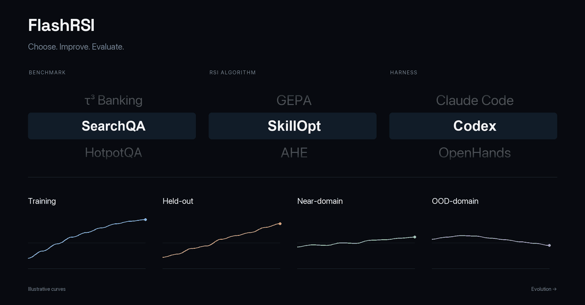
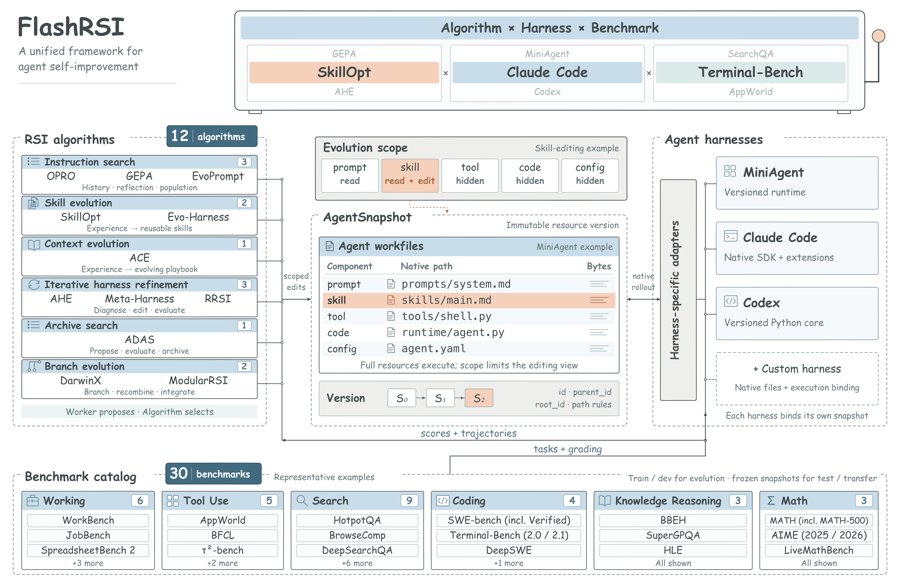
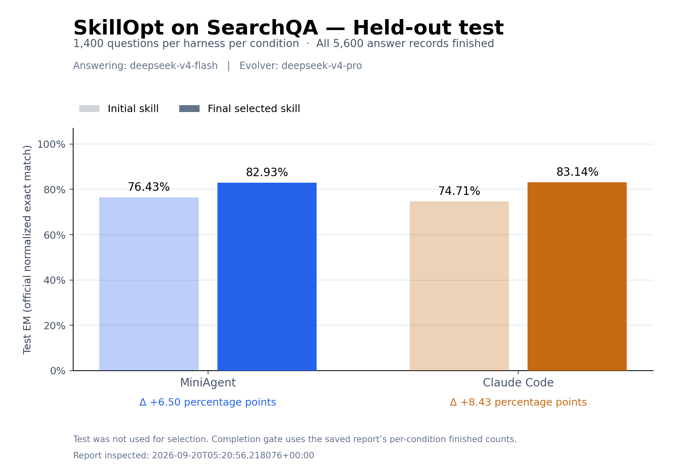

<p align="center">
  
</p>

<h1 align="center">FlashRSI: A Unified Framework for Agent Self-Improvement</h1>

<p align="center"><i>One click to reproduce any RSI algorithm with any benchmark and harness.</i></p>

<p align="center">
  FlashRSI 集成 <b>12 种 RSI 算法</b>、<b>30 个 benchmark</b> 和 <b>3 个 harness</b>（MiniAgent、Claude Code、Codex），用于复现、比较和开发 Agent 自我改进方法。
</p>

<!-- TODO: 发布前补充论文、项目主页、讨论区链接和许可证信息。 -->
<p align="center">
  <a href=""></a>
  <a href="https://github.com/ignorejjj/FlashRSI"></a>
  <a href=""></a>
  <a href="#demo"></a><br>
  <a href="docs/usage.zh-CN.md"></a>
  <a href=""></a>
  <a href=""></a>
</p>

<p align="center">
  <a href="README.md">English</a> · <b>简体中文</b>
</p>

<p align="center">
  <a href="#主要特性">主要特性</a> &nbsp;/&nbsp;
  <a href="#快速开始">快速开始</a> &nbsp;/&nbsp;
  <a href="#支持的算法">支持算法</a> &nbsp;/&nbsp;
  <a href="#支持的-harnesses">Harnesses</a> &nbsp;/&nbsp;
  <a href="#支持的-benchmarks">Benchmarks</a> &nbsp;/&nbsp;
  <a href="#实验结果">实验结果</a>
</p>

<a id="demo"></a>
<p align="center">
  
</p>

## 主要特性

- 🧩 **自由组合。** 独立选择 RSI 算法、benchmark 和 harness。
- 🎯 **控制改进范围。** 演化指令、skills、工具或 harness 代码。
- 📸 **记录候选版本。** 用 Snapshot 保存完整的候选资源。
- 📊 **检验泛化效果。** 追踪独立测试分数、任务轨迹与开销。

[使用文档 →](docs/usage.zh-CN.md)

<p align="center">
  <a href="assets/readme/framework-overview.svg">
    
  </a>
</p>

## 快速开始

### 1. 安装

```bash
git clone https://github.com/ignorejjj/FlashRSI.git
cd FlashRSI
pip install -e .
```

### 2. 一键运行

使用仓库自带的 12 道 QA 题目，运行 **SkillOpt × SearchQA × MiniAgent**。

**命令行**

```bash
flashrsi run \
  --algorithm skillopt --benchmark searchqa --agent miniagent \
  --model gpt-5-mini --worker-model gpt-5-mini \
  --benchmark.data_path examples/data/quickstart.jsonl \
  --algorithm.num_epochs 1 --algorithm.max_steps 1
```

**[YAML](examples/quickstart.yaml)**

```bash
flashrsi run --config examples/quickstart.yaml
```

结果保存在 `runs/`，见[分数、Snapshot 与轨迹说明](docs/running-experiments.md#read-the-results)。

## 支持的算法

| 算法（论文） | 可编辑资源 | 示例 |
| --- | --- | --- |
| [OPRO](https://arxiv.org/abs/2309.03409) | 指令 | [Config](examples/opro.yaml) |
| [GEPA](https://arxiv.org/abs/2507.19457) | 指令 | [Config](examples/gepa.yaml) |
| [EvoPrompt](https://arxiv.org/abs/2309.08532) | 指令 | [Config](examples/evoprompt.yaml) |
| [ACE](https://arxiv.org/abs/2510.04618) | 指令 / playbook | [Config](examples/ace.yaml) |
| [SkillOpt](https://arxiv.org/abs/2605.23904) | Skills | [Config](examples/quickstart.yaml) |
| [Evo-Harness](https://arxiv.org/abs/2608.15071v2) | Skills | [Config](examples/evo_harness.yaml) |
| [AHE](https://arxiv.org/abs/2604.25850) | Harness 资源 | [Config](examples/ahe.yaml) |
| [ADAS](https://arxiv.org/abs/2408.08435) | Harness 资源 | [Config](examples/adas.yaml) |
| [DarwinX](https://arxiv.org/abs/2608.07545) | Harness 资源 | [Config](examples/darwinx.yaml) |
| [Meta-Harness](https://arxiv.org/abs/2603.28052) | Harness 资源 | [Config](examples/meta_harness.yaml) |
| [ModularRSI](https://arxiv.org/abs/2609.14857) | Harness 资源 | [Config](examples/modular_rsi.yaml) |
| [RRSI](https://arxiv.org/abs/2609.24972) | Harness 资源 | [Config](examples/rrsi.yaml) |

实现适配到 FlashRSI 的资源与评估接口。Evo-Harness 和 harness 资源编辑方法需要 Agent Worker；具体条件见[选型与运行指南](docs/running-experiments.md#choose-an-algorithm-and-harness)。

## 支持的 Harnesses

| Harness | 可编辑资源 | 示例 |
| --- | --- | --- |
| [MiniAgent](docs/usage.zh-CN.md#原生-harness) | 指令、skills、工具、运行代码与配置 | [Config](examples/quickstart.yaml) |
| [Claude Code](docs/usage.zh-CN.md#原生-harness) | 指令、skills、子 Agent、hooks、工具服务与 settings | [Config](examples/searchqa_deepseek/claude_code.yaml) |
| [Codex](docs/codex.md) | 指令、skills、子 Agent、hooks、插件、记忆、工具与配置 | [Config](examples/codex.yaml) |

## 支持的 Benchmarks

`main` 包含 SearchQA、HotpotQA、Terminal-Bench 2.0 和 τ³ Banking；完整 **28 个 benchmark** 见[集合分支](https://github.com/ignorejjj/FlashRSI/tree/integration/flashrsi-smoke)，该分支支持 MiniAgent 和 Claude Code。开始前请查看[版本选择与环境准备](docs/running-experiments.md#choose-a-version)。

| Benchmark | 任务 | 评分 | 运行入口 |
| --- | --- | --- | --- |
| **问答** | | | |
| [SearchQA](https://github.com/ignorejjj/FlashRSI/tree/integration/flashrsi-smoke/flashrsi/benchmarks/searchqa) | 提供搜索片段的短答案问答 | 答案 EM / F1 | [Setup](docs/running-experiments.md#benchmarks-on-main) · [Config](examples/quickstart.yaml) |
| [HotpotQA](https://github.com/ignorejjj/FlashRSI/tree/integration/flashrsi-smoke/flashrsi/benchmarks/hotpotqa) | Wikipedia 多跳问答 | 答案 EM / F1；fullwiki 模式支持 joint F1 | [Setup](docs/running-experiments.md#benchmarks-on-main) · [Config](examples/hotpotqa.yaml) |
| [MuSiQue](https://github.com/ignorejjj/FlashRSI/tree/integration/flashrsi-smoke/flashrsi/benchmarks/musique) | 组合式多跳问答 | 答案 EM / F1；可选支撑段落 F1 | [Setup](https://github.com/ignorejjj/FlashRSI/blob/integration/flashrsi-smoke/docs/musique-independent-evolution.md) · [Config](https://github.com/ignorejjj/FlashRSI/blob/integration/flashrsi-smoke/examples/modular_rsi_musique.yaml) |
| [TriviaQA](https://github.com/ignorejjj/FlashRSI/tree/integration/flashrsi-smoke/flashrsi/benchmarks/triviaqa) | 基于 Wikipedia 上下文的知识问答 | 支持答案别名的 EM / F1 | [Setup](https://github.com/ignorejjj/FlashRSI/blob/integration/flashrsi-smoke/docs/triviaqa-independent-evolution.md) · [Config](https://github.com/ignorejjj/FlashRSI/blob/integration/flashrsi-smoke/examples/modular_rsi_triviaqa.yaml) |
| [Natural Questions](https://github.com/ignorejjj/FlashRSI/tree/integration/flashrsi-smoke/flashrsi/benchmarks/nq) | Wikipedia 问答，短答案与 yes/no 子集 | 本地文本 EM / F1 | [Setup](https://github.com/ignorejjj/FlashRSI/blob/integration/flashrsi-smoke/README.md#准备与检查) |
| [2WikiMultiHopQA](https://github.com/ignorejjj/FlashRSI/tree/integration/flashrsi-smoke/flashrsi/benchmarks/twowiki_multihopqa) | 基于给定上下文的多跳问答 | 答案 EM / F1 | [Setup](https://github.com/ignorejjj/FlashRSI/blob/integration/flashrsi-smoke/README.md#准备与检查) · [Config](https://github.com/ignorejjj/FlashRSI/blob/integration/flashrsi-smoke/examples/twowiki_multihopqa_opro.yaml) |
| **推理与数学** | | | |
| [BBEH](https://github.com/ignorejjj/FlashRSI/tree/integration/flashrsi-smoke/flashrsi/benchmarks/bbeh) | BIG-Bench Extra Hard 复杂推理 | 官方逐题准确率 | [Setup](https://github.com/ignorejjj/FlashRSI/blob/integration/flashrsi-smoke/docs/lightweight-benchmarks.md) · [Config](https://github.com/ignorejjj/FlashRSI/blob/integration/flashrsi-smoke/examples/bbeh_opro.yaml) |
| [SuperGPQA](https://github.com/ignorejjj/FlashRSI/tree/integration/flashrsi-smoke/flashrsi/benchmarks/supergpqa) | 研究生级别多项选择题 | 答案字母准确率 | [Setup](https://github.com/ignorejjj/FlashRSI/blob/integration/flashrsi-smoke/docs/lightweight-benchmarks.md) · [Config](https://github.com/ignorejjj/FlashRSI/blob/integration/flashrsi-smoke/examples/supergpqa_opro.yaml) |
| [HLE](https://github.com/ignorejjj/FlashRSI/tree/integration/flashrsi-smoke/flashrsi/benchmarks/hle) | Humanity's Last Exam，仅文本子集 | 官方 Judge 准确率 | [Setup](https://github.com/ignorejjj/FlashRSI/blob/integration/flashrsi-smoke/README.md#准备与检查) |
| [MATH](https://github.com/ignorejjj/FlashRSI/tree/integration/flashrsi-smoke/flashrsi/benchmarks/math) | 竞赛数学 | Math-Verify 等价性准确率 | [Setup](https://github.com/ignorejjj/FlashRSI/blob/integration/flashrsi-smoke/docs/math-independent-evolution.md) · [Config](https://github.com/ignorejjj/FlashRSI/blob/integration/flashrsi-smoke/examples/modular_rsi_math500.yaml) |
| [AIME](https://github.com/ignorejjj/FlashRSI/tree/integration/flashrsi-smoke/flashrsi/benchmarks/aime) | AIME 2025 / 2026 数学题 | 整数答案准确率 | [Setup](https://github.com/ignorejjj/FlashRSI/blob/integration/flashrsi-smoke/docs/coding-math-benchmarks.md) · [Config](https://github.com/ignorejjj/FlashRSI/blob/integration/flashrsi-smoke/examples/aime_opro.yaml) |
| [LiveMathBench](https://github.com/ignorejjj/FlashRSI/tree/integration/flashrsi-smoke/flashrsi/benchmarks/livemathbench) | 多次采样的数学评测 | G-Pass@k / mG-Pass@k | [Setup](https://github.com/ignorejjj/FlashRSI/blob/integration/flashrsi-smoke/README.md#准备与检查) |
| **代码** | | | |
| [CRUXEval-O](https://github.com/ignorejjj/FlashRSI/tree/integration/flashrsi-smoke/flashrsi/benchmarks/cruxeval_output) | Python 函数输出预测 | Python 字面量相等准确率 | [Setup](https://github.com/ignorejjj/FlashRSI/blob/integration/flashrsi-smoke/docs/coding-math-benchmarks.md) · [Config](https://github.com/ignorejjj/FlashRSI/blob/integration/flashrsi-smoke/examples/cruxeval_output_opro.yaml) |
| [SWE-bench Verified](https://github.com/ignorejjj/FlashRSI/tree/integration/flashrsi-smoke/flashrsi/benchmarks/swe_bench) | 代码仓库 issue 修复 | 官方 verifier 修复率 | [Setup](https://github.com/ignorejjj/FlashRSI/blob/integration/flashrsi-smoke/docs/swe-independent-evolution.md) · [Config](https://github.com/ignorejjj/FlashRSI/blob/integration/flashrsi-smoke/examples/modular_rsi_swe_bench.yaml) |
| [SWE-bench Pro V2](https://github.com/ignorejjj/FlashRSI/tree/integration/flashrsi-smoke/flashrsi/benchmarks/swe_bench_pro) | 代码仓库修复，all / hard 题集 | 官方容器复评修复率 | [Setup](https://github.com/ignorejjj/FlashRSI/blob/integration/flashrsi-smoke/README.md#准备与检查) |
| **网页研究** | | | |
| [BrowseComp](https://github.com/ignorejjj/FlashRSI/tree/integration/flashrsi-smoke/flashrsi/benchmarks/browsecomp) | 网络信息搜索 | 官方答案 Judge 准确率 | [Setup](https://github.com/ignorejjj/FlashRSI/blob/integration/flashrsi-smoke/README.md#准备与检查) · [Config](https://github.com/ignorejjj/FlashRSI/blob/integration/flashrsi-smoke/examples/browsecomp_serper_jina.yaml) |
| [DeepSearchQA](https://github.com/ignorejjj/FlashRSI/tree/integration/flashrsi-smoke/flashrsi/benchmarks/deepsearchqa) | 单答案与集合答案的网络搜索 | 官方 autorater F1 | [Setup](https://github.com/ignorejjj/FlashRSI/blob/integration/flashrsi-smoke/docs/web-research-services.md) · [Config](https://github.com/ignorejjj/FlashRSI/blob/integration/flashrsi-smoke/examples/deepsearchqa_serper_jina.yaml) |
| [WideSearch](https://github.com/ignorejjj/FlashRSI/tree/integration/flashrsi-smoke/flashrsi/benchmarks/widesearch) | 表格型广泛信息搜索 | 官方表格评分 | [Setup](https://github.com/ignorejjj/FlashRSI/blob/integration/flashrsi-smoke/README.md#准备与检查) |
| **文档与工具使用** | | | |
| [OfficeQA-Pro](https://github.com/ignorejjj/FlashRSI/tree/integration/flashrsi-smoke/flashrsi/benchmarks/officeqa_pro) | 文档检索问答 | 数值 / 文本答案准确率 | [Setup](https://github.com/ignorejjj/FlashRSI/blob/integration/flashrsi-smoke/docs/web-research-services.md) · [Config](https://github.com/ignorejjj/FlashRSI/blob/integration/flashrsi-smoke/examples/officeqa_pro_opro.yaml) |
| [Harvey LAB](https://github.com/ignorejjj/FlashRSI/tree/integration/flashrsi-smoke/flashrsi/benchmarks/harvey_lab) | 法律文档任务 | 双 Judge rubric 全部通过率 | [Setup](https://github.com/ignorejjj/FlashRSI/blob/integration/flashrsi-smoke/README.md#准备与检查) |
| [JobBench](https://github.com/ignorejjj/FlashRSI/tree/integration/flashrsi-smoke/flashrsi/benchmarks/jobbench) | 专业文件交付 | 官方加权 rubric reward | [Setup](https://github.com/ignorejjj/FlashRSI/blob/integration/flashrsi-smoke/README.md#准备与检查) |
| [AppWorld](https://github.com/ignorejjj/FlashRSI/tree/integration/flashrsi-smoke/flashrsi/benchmarks/appworld) | 应用与 API 自动化 | 官方任务完成 reward | [Setup](https://github.com/ignorejjj/FlashRSI/blob/integration/flashrsi-smoke/docs/appworld-independent-evolution.md) · [Config](https://github.com/ignorejjj/FlashRSI/blob/integration/flashrsi-smoke/examples/modular_rsi_appworld.yaml) |
| [BFCL V4](https://github.com/ignorejjj/FlashRSI/tree/integration/flashrsi-smoke/flashrsi/benchmarks/bfcl) | 多轮函数调用，仅 Base track | 官方会话成功率 | [Setup](https://github.com/ignorejjj/FlashRSI/blob/integration/flashrsi-smoke/README.md#准备与检查) |
| [WorkBench](https://github.com/ignorejjj/FlashRSI/tree/integration/flashrsi-smoke/flashrsi/benchmarks/workbench) | 工作场景工具操作 | 原生数据库结果正确率 | [Setup](https://github.com/ignorejjj/FlashRSI/blob/integration/flashrsi-smoke/docs/workbench.md) · [Config](https://github.com/ignorejjj/FlashRSI/blob/integration/flashrsi-smoke/examples/workbench_opro.yaml) |
| [TravelPlanner](https://github.com/ignorejjj/FlashRSI/tree/integration/flashrsi-smoke/flashrsi/benchmarks/travelplanner) | 旅行行程规划，仅 sole-planning track | 最终约束通过率 | [Setup](https://github.com/ignorejjj/FlashRSI/blob/integration/flashrsi-smoke/README.md#准备与检查) |
| **交互环境** | | | |
| [τ²-bench](https://github.com/ignorejjj/FlashRSI/tree/integration/flashrsi-smoke/flashrsi/benchmarks/tau2) | 航空、零售、电信多轮对话，文本模式 | 原生 reward 均值 | [Setup](https://github.com/ignorejjj/FlashRSI/blob/integration/flashrsi-smoke/docs/tau2-bench.md) · [Config](https://github.com/ignorejjj/FlashRSI/blob/integration/flashrsi-smoke/examples/tau2_opro.yaml) |
| [τ³ Banking](https://github.com/ignorejjj/FlashRSI/tree/integration/flashrsi-smoke/flashrsi/benchmarks/tau3_banking) | 多轮银行客服 | 原生 tau2 reward | [Setup](docs/running-experiments.md#benchmarks-on-main) · [Config](examples/tau3_banking.yaml) |
| [Terminal-Bench 2.0](https://github.com/ignorejjj/FlashRSI/tree/integration/flashrsi-smoke/flashrsi/benchmarks/terminal_bench) | 通过 Harbor 执行的 Linux 终端任务 | 原生 verifier reward | [Setup](docs/terminal-bench.md) · [Config](examples/terminal_bench.yaml) |

Config 链接指向可用的 YAML；仅有 Setup 的条目尚无现成 YAML。ModularRSI 示例还需独立演化数据与模块文件，见[运行指南](docs/running-experiments.md#benchmark-collection)。

## 实验结果

**SkillOpt 在两个原生 harness 上优化 SearchQA 表现。** 解题模型为 `deepseek-v4-flash`，改进模型为 `deepseek-v4-pro`。两侧使用相同的 400 / 200 / 1,400 train / dev / test 划分、seed 42，以及 4 epochs / 40 fast steps 的预算。候选使用 dev 筛选，冻结最终 Snapshot 后再评估 test。

| Harness | 初始 test EM | 最终 test EM | 提升 |
| --- | ---: | ---: | ---: |
| MiniAgent | 76.43% | **82.93%** | **+6.50 个百分点** |
| Claude Code | 74.71% | **83.14%** | **+8.43 个百分点** |

<p align="center">
  
</p>

以上结果对应这一组 DeepSeek 迁移实验。[实验报告](experiments/skillopt-searchqa-deepseek-20260920-seed42/report.md)、[独立验收记录](experiments/skillopt-searchqa-deepseek-20260920-seed42/evidence/full-verification.json)和[复现说明](docs/searchqa-deepseek-reproduction.md)提供完整分数、用量及与上游实验协议的差异。

<details id="citation">
<summary>引用</summary>

<!-- TODO: 报告发布后补充链接和出版信息。 -->
```bibtex
@misc{jin2026flashrsi,
  title  = {FlashRSI: A Unified Framework for Agent Self-Improvement},
  author = {Jiajie Jin and Yuze Li and Yuyang Hu and Guanting Dong and
            Xiaoxi Li and Xinyu Yang and Zhicheng Dou and Yutao Zhu},
  year   = {2026}
}
```

</details>

---

<p align="center">
  <b>中国人民大学 · 高瓴人工智能学院</b>
</p>
