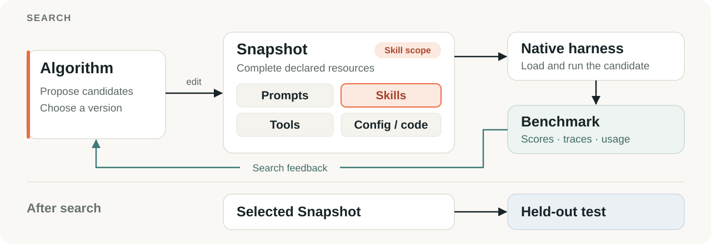

# 使用指南

[返回 README](../README.zh-CN.md) · [English](usage.md)

## 配置实验

本文中的命令均在仓库根目录执行。[快速示例配置](../examples/quickstart.yaml) 使用 SkillOpt 和 MiniAgent，附带 12 道本地 QA 题目，分别划分为 train、dev 和 test。

Target 和 Worker 各自使用独立的模型与连接配置：

| 角色 | 配置位置 | 职责 |
| --- | --- | --- |
| **Target** | `agent.llm` | 使用指定资源版本完成 benchmark 任务。 |
| **Worker** | `algorithm.worker.llm` | 提出改进；使用 Agent Worker 时，也可以直接编辑候选文件。 |

分别填写两个角色的 `model_name` 和 `api_key`；使用自定义端点时，填写 `base_url`。配置加载器按字面读取 YAML 值。使用环境变量时，请在 shell 中展开：

```bash
uv run flashrsi run --config examples/quickstart.yaml \
  --model "$TARGET_MODEL" \
  --worker-model "$WORKER_MODEL" \
  --agent.llm.api_key "$TARGET_API_KEY" \
  --algorithm.worker.llm.api_key "$WORKER_API_KEY"
```

### 准备实验，不调用模型

```bash
uv run flashrsi run --config examples/quickstart.yaml --prepare-only
```

这条命令会创建实验目录并保存配置，不需要 API key，也不会调用模型。本地 QA 示例用于体验流程，研究结果请使用完整 benchmark 数据集。

### 更换组合

所有配置字段都可以用点路径命令行参数覆盖。例如，将快速示例从技能学习改为指令搜索：

```bash
uv run flashrsi run --config examples/quickstart.yaml \
  --algorithm opro \
  --algorithm.max_steps 1 \
  --algorithm.num_candidates 2
```

使用其他 harness 或任务集时，可以从对应配置开始：

| 尝试内容 | 配置 | 额外依赖 |
| --- | --- | --- |
| Codex 同时作为 Target 和 Worker | [examples/codex.yaml](../examples/codex.yaml) | `codex`；运行环境见 [Codex 接入说明](codex.md) |
| 多跳问答 | [examples/hotpotqa.yaml](../examples/hotpotqa.yaml) | Target 和 Worker 对应的 extras |
| Terminal-Bench 2.0 | [examples/terminal_bench.yaml](../examples/terminal_bench.yaml) | `harbor`、Python 3.12+、Docker |
| τ³ Banking | [examples/tau3_banking.yaml](../examples/tau3_banking.yaml) | `tau2` 和上游 benchmark |

请为选中的每个角色安装相应 extras。Harbor 与 tau2 的上游依赖存在冲突，需要安装在不同环境中。准备步骤与验证范围见 [Terminal-Bench 接入说明](terminal-bench.md)、[Codex 接入说明](codex.md)和对应配置。

### 使用 pip 安装

除了 README 中的 uv 安装方式，也可以使用 pip：

```bash
python -m venv .venv
source .venv/bin/activate
pip install -e '.[miniagent,llm]'
```

后续命令中的 `uv run flashrsi` 相应改为 `flashrsi`。

## 原生 harness

| Harness | 执行方式 | 版本化资源 |
| --- | --- | --- |
| [MiniAgent](../flashrsi/agents/miniagent) | 原生 Python Agent | 指令、skills、工具、配置及声明的运行代码 |
| [Claude Code](agent-integration.md) | 官方 Agent SDK | 指令、skills、commands、agents、hooks、MCP/LSP 注册及 settings |
| [Codex](codex.md) | 原生 Codex runtime | 指令、skills、agents、hooks、MCP 服务、插件 bundle、记忆资源、规则和配置；具体执行模式见接入说明 |

**计划接入：** OpenHands、Pi、Hermes，演示中一并展示。

同一个 Agent 接口既可以作为解题的 Target，也可以作为编辑文件的 Worker。对于请求文本或结构化编辑建议的方法，还可以使用纯 **LLM Worker**。

## 工作原理

<p align="center">
  
</p>

### 局部编辑，完整执行

一个 skill 的效果依赖周围的指令、工具和执行逻辑。**Snapshot** 记录 harness 声明的完整资源版本；编辑 **scope** 决定算法能读取和修改哪些部分，执行时仍保留其余资源。

原生 harness 继续负责资源加载和执行。开放源码的 harness 可以暴露运行代码；通过 CLI 或 SDK 接入的 harness 可以暴露指令、配置和扩展。凭据、依赖、任务目录和运行状态不进入资源版本。

### 共用操作，各自搜索

OPRO 使用带评分的历史，EvoPrompt 维护种群，SkillOpt 结合快速编辑与较慢的指导更新。它们共用候选构造、执行和评分设施，算法自己决定何时提出候选、如何保留搜索记忆，以及采用哪个版本。

**评估候选和激活候选是两个操作。** 候选的父版本记录资源从哪里继承；算法提出这个候选时，可以参考多个版本的证据。

### 搜索中提供反馈，搜索后检验效果

Benchmark 提供分数、逐题结果、轨迹及可用的用量统计。算法自行选择哪些证据用于反思和筛选。Harness 决定 Agent 如何执行，benchmark 决定任务如何评分。

搜索结束后，runner 在 test 划分上评估选中的 Snapshot。你也可以冻结这个版本，在另一个 benchmark 上测试迁移效果。

## Python API

自定义实验时，可以直接使用相同的组件：

```python
import asyncio

from flashrsi.agents import LLM, MiniAgent
from flashrsi.algorithms import SkillOpt
from flashrsi.benchmarks import SearchQA
from flashrsi.config import load_config


async def main():
    config = load_config("examples/quickstart.yaml")
    target = MiniAgent(config.agent)
    worker = LLM(config.algorithm.worker)
    benchmark = SearchQA(config.benchmark)
    algorithm = SkillOpt(
        config.algorithm, target=target, worker=worker, benchmark=benchmark
    )

    selected = await algorithm.evolve()
    results = benchmark.grade(await target.rollout(benchmark.test, snapshot=selected))
    selected.save("snapshot.json")
    print([dict(item.metrics) for item in results])


asyncio.run(main())
```

需要自行控制流程时，用 `snapshot.check_out()` 和 `snapshot.commit()` 构造候选，调用 `target.rollout(tasks, snapshot=candidate)` 评估，再用 `target.update(candidate)` 将其选为后续运行使用的版本。

## 实验记录

每次 CLI 运行都会创建独立目录：

```text
runs/<algorithm>-<agent>-<benchmark>-<timestamp>/
├── config.yaml           # 保存的配置，凭据已脱敏
├── snapshots/            # 资源版本及其继承关系
├── trajectories/         # Target 执行、Worker 调用和搜索决策
├── result.json           # 选中的 Snapshot 和最终 test 结果
├── end-summary.json      # 供程序读取的实验摘要
└── end-summary.md        # 供人工阅读的实验摘要
```

分数和轨迹始终关联到产生它们的资源版本。Target 与 Worker 分别记录，便于同时查看解题行为和改进开销。用量统计以各原生 harness 实际提供的信息为准。

## 扩展 FlashRSI

| 接入内容 | 需要实现 | 参考入口 |
| --- | --- | --- |
| **Harness** | 声明资源组件，通过 `Agent._run` 接入原生执行。 | [Agent 接入说明](agent-integration.md) |
| **RSI 方法** | 声明编辑与观察 scope，在 `Algorithm.evolve` 中组织搜索。 | [算法实现](../flashrsi/algorithms) |
| **Benchmark** | 提供任务和评分；需要环境执行时，绑定执行器。 | [Benchmark 接口](../flashrsi/core/benchmark.py) |

下面的小型离线示例演示资源 checkout、文件编辑、候选评估和激活：

```bash
uv run python examples/agents/native_adapters.py
```

示例使用本地子进程和明确模拟的 SDK。更详细的早期实现记录见[归档说明](implementation-notes.zh-CN.md)。

## 开发检查与图片生成

```bash
uv sync --extra dev
uv run pytest
uv run ruff check .
uv run ruff format --check .
```

[动态封面](../assets/readme/cover.gif)直接使用 React Bits ElectricLogo 组件渲染，附 [PNG 静态预览](../assets/readme/cover.png)、[录制说明](../scripts/readme-cover/README.md)和[设计说明](../assets/readme/cover-design.md)。演示 GIF 由 [scripts/render_readme_hero.py](../scripts/render_readme_hero.py) 使用 Pillow 生成，训练和评估曲线均为示意。图片已保存在 `assets/readme/`，查看 README 无需运行渲染脚本。
