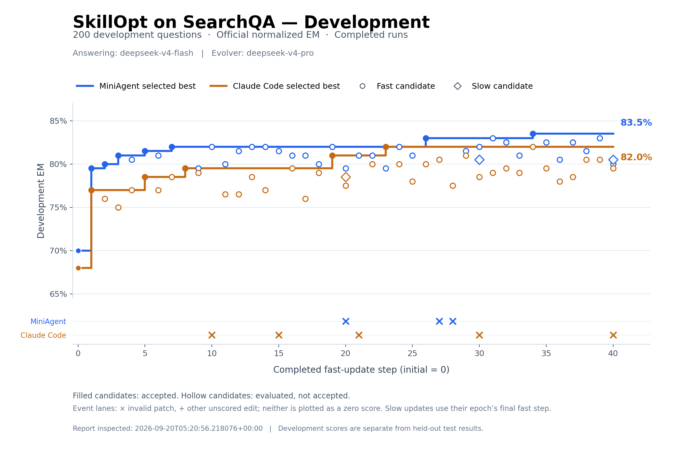

# SkillOpt / SearchQA：DeepSeek 实验记录

2026-09-19 至 2026-09-20，seed 42；train/dev/test = 400/200/1400。
答题模型为 DeepSeek-v4-flash，演化模型为 DeepSeek-v4-pro。这是迁移复现实验，模型与部分算法、harness 细节不同于原论文。

| Agent | 初始 test EM | 最终 test EM | 提升 | 接受候选 / 全部决策 | 运行尝试 | 失败请求记录 |
| --- | ---: | ---: | ---: | ---: | ---: | ---: |
| MiniAgent | 76.43% | 82.93% | +6.50 pp | 7 / 43 | 20 | 95 |
| Claude Code | 74.71% | 83.14% | +8.43 pp | 5 / 43 | 5 | 5 |

候选选择使用 dev；test 在演化完成后评测，不参与选择。恢复运行的轨迹副本不重复计数。

## 阅读顺序

- [结果报告](report.md)：EM、F1、配对比较与用量说明。
- [完整决策过程](process.md)：按时间顺序浏览 86 次候选决策，包括拒绝和未评分编辑。
- [MiniAgent](miniagent/) / [Claude Code](claude_code/)：`config.yaml` 和 `plan.json` 保存参数，`decisions.jsonl` 保存全部候选修改和理由，`evaluations.jsonl` 保存各阶段评测汇总。
- 两个 agent 的 `test-predictions.csv` 各有 1,400 行：题目 ID、标准答案、初始/最终回答和 EM/F1，可重新统计结果。
- `skills/index.json` 标出初始、最终及中间技能版本；对应子目录保存可直接阅读的技能文本。
- `attempts.json`、`failures.jsonl`、`protocol-retries.jsonl` 和 `logs/` 保留恢复、失败与重试经过；`end-summary.md/json` 保存原有用量统计。
- [数据清单](data-manifest.json) 保存数据来源版本、划分和题目 ID；[导出校验](verification.json) 保存逐题分数与计数核对结果。

## 精简范围

这是一份供 Git 浏览的过程记录，不是完整对话或可直接续跑的目录。删除了提交包中的重复 attempt 轨迹、请求缓存、长 prompt、完整消息历史、重复数据上下文和临时文件。独有原始文件没有丢弃：完整文件已按 SHA-256 去重并压缩为本地备份 `searchqa-full-original.tar.gz`，所有 34,847 个文件均已逐一核验。备份不放入本次 Git 提交目录。

技能文件从原始 snapshot 解码，只导出 skill 组件；目录名保留原 snapshot ID，不表示精简目录可作为完整 snapshot 加载。源代码、完整 snapshot 及每次 worker 对话在备份中。

本机路径与模型网关地址已替换为 `<HOME>`、`<REPOSITORY>`、`original-run/` 和 `https://MODEL_ENDPOINT`。配置用于记录历史参数，重新运行需要配置自己的服务地址、凭据和数据路径。`evidence/` 是历史核验记录，其中路径和散列指向原始材料；精简版自身的文件散列见 `manifest.json`。

EM/F1、改善及退步题数已从导出的 CSV 重新计算，与保存结果一致；本次整理没有重新调用模型。SDK 费用是原始日志中的估算，不代表网关实际账单。原始运行版本与修复指纹见配置及 evidence；整理时的代码版本不作为原始运行版本。
